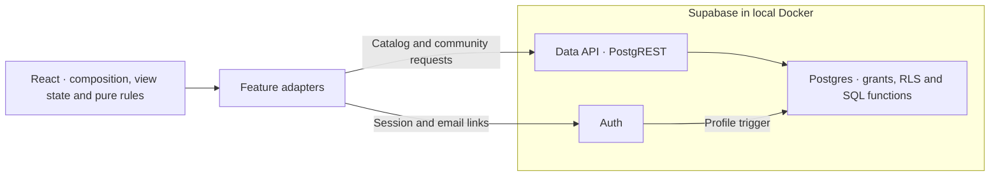

# Where Mathutando runs

## Today

| Responsibility | Runtime | Where to look |
| --- | --- | --- |
| Screens, navigation, catalog filters and exercise preview | React in the browser | [Web app](../apps/web/src/) |
| Requests and response mapping for the catalog, community and identity | Feature adapters in the browser | [Library API](../apps/web/src/features/library/api.ts), [feed API](../apps/web/src/features/feed/api.ts), [auth adapter](../apps/web/src/features/auth/api.ts) |
| Sessions and email links | Supabase Auth | [Local configuration](../supabase/config.toml) |
| Persistence, generated Data API and row access | Supabase PostgreSQL + PostgREST | [Initial migration](../supabase/migrations/20261123170000_initial.sql) |
| Controlled publishing and account profile creation | SQL function and trigger | [Initial migration](../supabase/migrations/20261123170000_initial.sql) |
| Shape of a learner-facing exercise | TypeScript and Zod | [Exercise contract](../packages/contracts/src/index.ts) |

In local development, Vite serves the browser app and Docker runs Supabase. Supabase is the backend. The browser talks directly to its Auth and Data API with a public client key and, after login, the user's session. Postgres permissions and row policies govern those requests. The [Supabase Data API docs](https://supabase.com/docs/guides/api) describe the generated API. The SQL publishing function exists but the current app does not offer an authoring workflow.

The coupling concern is real. Originally `App.tsx` held network loading, catalog rules, navigation, layout and a direct SDK call for sign-out. Library and community callers also depend on feature API functions backed by Supabase. Splitting UI composition, async state, pure selectors and adapters lets us test behaviors independently without replacing the working backend. This pass applies that split to the shell, catalog, preview and community. The adapters remain the places to change queries and shape responses.

## First server use case

When we implement assessment, introduce a single use case for submitting an answer. Its server entry point authenticates the caller and validates the payload. The use case loads the attempt and its exercise version, reads the private answer key, invokes a pure evaluator, records the result and returns learner-facing feedback. Persist a completed submission with its feedback atomically and give retries a stable submission identifier. The browser keeps the interaction state, and the public contract keeps the allowed request and response shapes.

Consider a [Supabase Edge Function](https://supabase.com/docs/guides/functions) as the initial HTTP entry point if grading needs a TypeScript runtime. Keep its request handling thin. A database transaction can own consistency across related writes; network placement does not make a sequence of separate writes atomic. Add a separate runtime only when there is a concrete requirement for it. While assessment is absent, use the existing catalog and community APIs with their row policies.

The published exercise definition and private evaluation data have different consumers. Give assessment tests fixed prompts, attempts and answer keys in memory. Test identity, version ownership and duplicate submission behavior against local Supabase when the server use case exists.

See the [accepted infrastructure decision](adr/0002-supabase-cloudflare.md).
